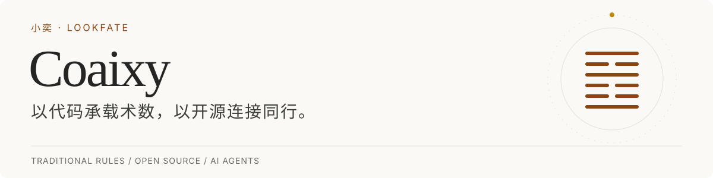

<picture>
  <source media="(prefers-color-scheme: dark)" srcset="assets/profile-dark.svg">
  <source media="(prefers-color-scheme: light)" srcset="assets/profile-light.svg">
  
</picture>

我是 **小奕（Coaixy）**，关注**传统术数的程序化实现与 AI Agent 应用**，主理开源组织 [LookFate](https://github.com/look-fate)。

我关心规则怎样变成代码、模型怎样使用工具，以及计算与解读的结果怎样被检查。

[公开项目](#公开项目) · [参与合作](#参与合作) · [个人网站](https://www.letfate.com) · [邮件联系](mailto:coaixy@outlook.com)

### 正在做：FateClaw（开发中）

开发面向东方术数排盘与 AI 解读的应用，探索把排盘工具、知识检索与 Agent 交互连接起来。

### 公开项目

| 项目 | 做什么 |
| --- | --- |
| [liuren-ts-lib](https://github.com/look-fate/liuren-ts-lib) | 大六壬排盘 TypeScript 库，提供结构化结果与调用接口。 |
| [xuanxue-skill](https://github.com/Coaixy/xuanxue-skill) | 面向 Agent 的术数 Skill 集合，整理不同术数的使用框架与参考资料。 |
| [fate_benchmark](https://github.com/look-fate/fate_benchmark) | 基于 BaziQA 数据的模型评测流程，记录回答、评分与分项统计。 |
| [TCM-Ancient-Books](https://github.com/Coaixy/TCM-Ancient-Books) | 中医古籍 OCR 文本的专题整理与检索预处理。 |

### 参与合作

欢迎对术数、开源软件与 AI 应用感兴趣的朋友一起推进具体问题：

- **熟悉术数规则**：核对规则出处、补充盘例，说明流派差异与适用条件。
- **开发软件与 Agent**：完善算法实现、调用示例、交互体验与工具接入。
- **使用或研究项目**：提交可复现的问题，补充测试案例与评测方法。

具体问题请在对应仓库提交 Issue；跨项目合作可以[发邮件](mailto:coaixy@outlook.com)，说明你在做什么、已有进展和希望一起完成的部分。

---

Building open tools for traditional Chinese metaphysics and AI agents.
