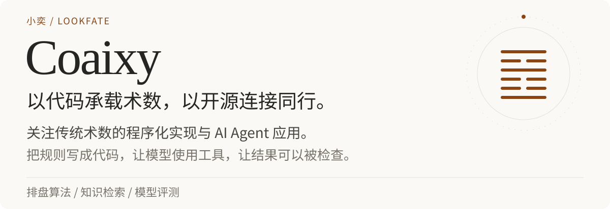
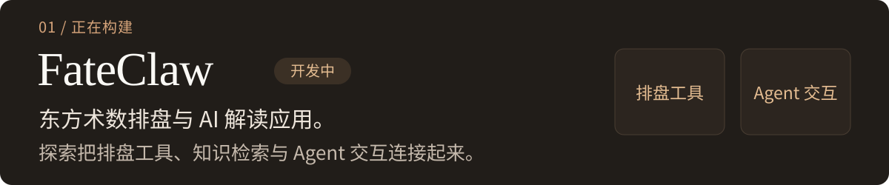
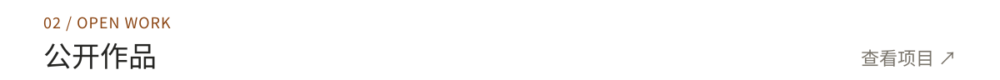
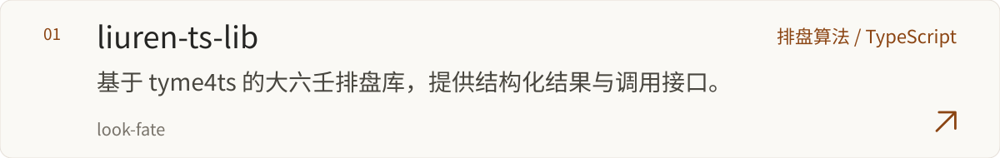
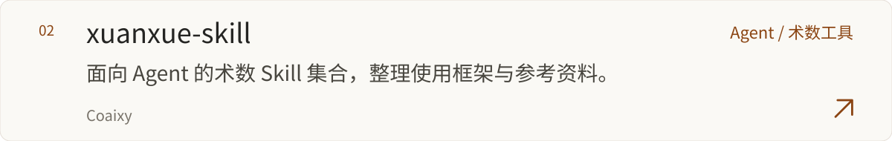
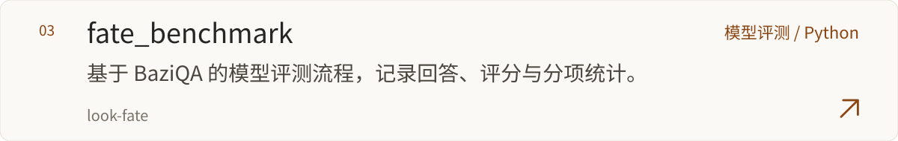
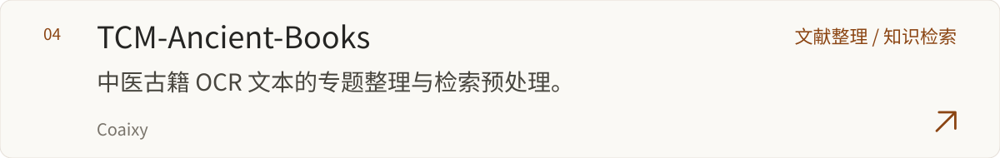
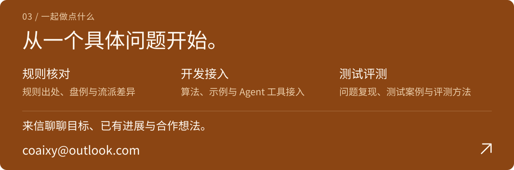

  <a href="https://github.com/look-fate">
    <picture>
      <source media="(max-width: 767px) and (prefers-color-scheme: dark)" srcset="assets/hero-dark-mobile.svg">
      <source media="(max-width: 767px)" srcset="assets/hero-light-mobile.svg">
      <source media="(prefers-color-scheme: dark)" srcset="assets/hero-dark.svg">
      
    </picture>
  </a>

    <picture>
      <source media="(max-width: 767px) and (prefers-color-scheme: dark)" srcset="assets/current-dark-mobile.svg">
      <source media="(max-width: 767px)" srcset="assets/current-light-mobile.svg">
      <source media="(prefers-color-scheme: dark)" srcset="assets/current-dark.svg">
      
    </picture>

    <picture>
      <source media="(max-width: 767px) and (prefers-color-scheme: dark)" srcset="assets/projects-dark-mobile.svg">
      <source media="(max-width: 767px)" srcset="assets/projects-light-mobile.svg">
      <source media="(prefers-color-scheme: dark)" srcset="assets/projects-dark.svg">
      
    </picture>

  <a href="https://github.com/look-fate/liuren-ts-lib">
    <picture>
      <source media="(max-width: 767px) and (prefers-color-scheme: dark)" srcset="assets/project-liuren-dark-mobile.svg">
      <source media="(max-width: 767px)" srcset="assets/project-liuren-light-mobile.svg">
      <source media="(prefers-color-scheme: dark)" srcset="assets/project-liuren-dark.svg">
      
    </picture>
  </a>

  <a href="https://github.com/Coaixy/xuanxue-skill">
    <picture>
      <source media="(max-width: 767px) and (prefers-color-scheme: dark)" srcset="assets/project-skills-dark-mobile.svg">
      <source media="(max-width: 767px)" srcset="assets/project-skills-light-mobile.svg">
      <source media="(prefers-color-scheme: dark)" srcset="assets/project-skills-dark.svg">
      
    </picture>
  </a>

  <a href="https://github.com/look-fate/fate_benchmark">
    <picture>
      <source media="(max-width: 767px) and (prefers-color-scheme: dark)" srcset="assets/project-benchmark-dark-mobile.svg">
      <source media="(max-width: 767px)" srcset="assets/project-benchmark-light-mobile.svg">
      <source media="(prefers-color-scheme: dark)" srcset="assets/project-benchmark-dark.svg">
      
    </picture>
  </a>

  <a href="https://github.com/Coaixy/TCM-Ancient-Books">
    <picture>
      <source media="(max-width: 767px) and (prefers-color-scheme: dark)" srcset="assets/project-books-dark-mobile.svg">
      <source media="(max-width: 767px)" srcset="assets/project-books-light-mobile.svg">
      <source media="(prefers-color-scheme: dark)" srcset="assets/project-books-dark.svg">
      
    </picture>
  </a>

  <a href="mailto:coaixy@outlook.com">
    <picture>
      <source media="(max-width: 767px) and (prefers-color-scheme: dark)" srcset="assets/collaboration-dark-mobile.svg">
      <source media="(max-width: 767px)" srcset="assets/collaboration-light-mobile.svg">
      <source media="(prefers-color-scheme: dark)" srcset="assets/collaboration-dark.svg">
      
    </picture>
  </a>

  <a href="https://www.letfate.com">
    <picture>
      <source media="(max-width: 767px) and (prefers-color-scheme: dark)" srcset="assets/footer-dark-mobile.svg">
      <source media="(max-width: 767px)" srcset="assets/footer-light-mobile.svg">
      <source media="(prefers-color-scheme: dark)" srcset="assets/footer-dark.svg">
      
    </picture>
  </a>

